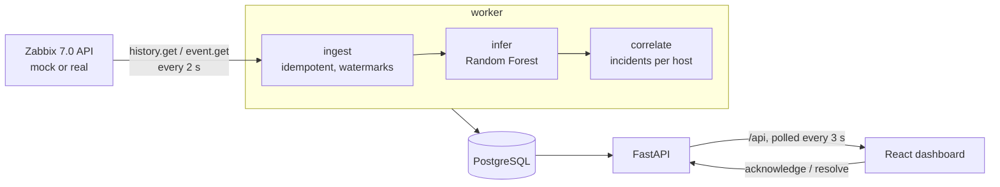
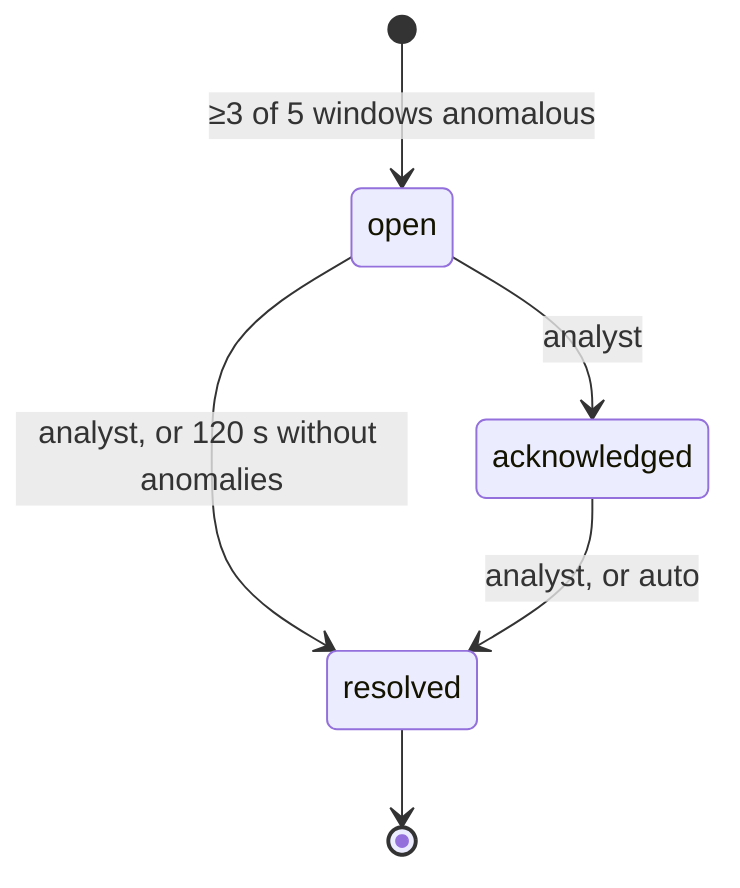
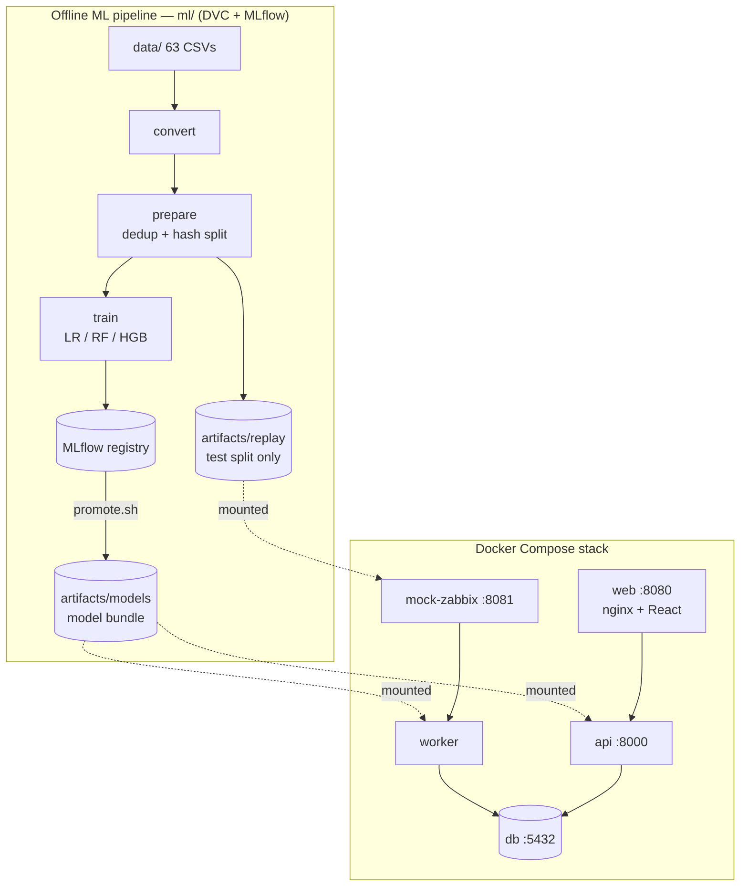
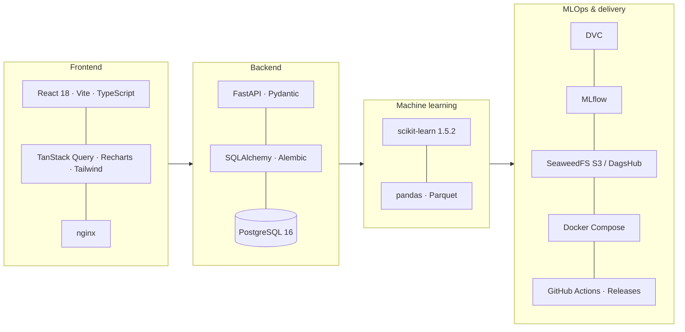

# NetAD — AI-assisted network anomaly detection for pfSense / Zabbix

NetAD adds a machine-learning detection layer to a pfSense + Zabbix monitoring stack. A worker pulls flow-window
telemetry from the Zabbix JSON-RPC API, scores every window with a Random Forest trained on CICIoT2023-derived
data, groups anomalous windows into incidents, and shows them on a React dashboard.

> Scores are **model predictions**, not confirmed attacks. The dashboard always says "suspected" and shows the score.

- Code: https://github.com/ab2ssamad6/pfa
- Dataset, models, experiments: https://dagshub.com/ab2ssamad6/pfa

## 1. Run the project

Requirements: Docker with Compose v2, ~4 GB free RAM, ports 8080, 8000, 8081 and 5432 free.

```bash
git clone https://github.com/ab2ssamad6/pfa.git && cd pfa
./scripts/start.sh      # first run downloads the trained model + replay pool (~85 MB, sha256-verified)
```

| URL | What |
|---|---|
| http://localhost:8080 | Dashboard |
| http://localhost:8000/docs | API (OpenAPI) |
| http://localhost:8081 | Mock Zabbix JSON-RPC |

The demo scenario starts with the mock and loops every 60 s: **recon at +10 s, DDoS at +22 s, web attack at
+48 s**. Walkthrough: [docs/demo.md](docs/demo.md).

```bash
./scripts/smoke.sh            # end-to-end check of the running stack
./scripts/demo.sh outage 30   # simulate a 30 s Zabbix outage
./scripts/demo.sh restart     # restart the scenario timeline
./scripts/stop.sh             # stop (data kept)   |  ./scripts/reset.sh  stop and delete the database
./scripts/test.sh             # all test suites in Docker
```

No training is needed to run the stack: the deployed model is pulled from DVC, or from the GitHub Release
`v1.0` when no DVC credentials are configured.

## 2. Retrain and deploy a model

Retraining needs the 9.3 GB dataset from DagsHub: create a free account and put a token in
`.dvc/config.local` (see the comments in `.dvc/config`).

```bash
./scripts/train.sh            # dvc repro in Docker: reruns changed stages, logs to MLflow, registers "candidate"
./scripts/dvc.sh metrics diff # compare with the previous run (or use the MLflow UI)
./scripts/promote.sh          # candidate → artifacts/models (sha256 checked) → alias "production" → dvc push
git add dvc.lock artifacts/models.dvc params.yaml && git commit -m "model: promote <version>"
./scripts/restart.sh api worker
```

Hyperparameters live in `params.yaml`. Rollback: `./scripts/promote.sh <registry version>`.
MLflow runs locally (`./scripts/mlops.sh up`, UI at http://localhost:5050) or on DagsHub when
`MLFLOW_TRACKING_URI` is set in `.env`. Details: [docs/mlops.md](docs/mlops.md).

## 3. How it works



1. **Ingest.** Each host exposes one text item, `netad.flow.features`, holding a JSON object of window features.
   Numeric items (bandwidth, CPU, firewall states) and Zabbix problems are stored as context.
2. **Infer.** Every new window gets an attack score and a category distribution (8 classes). A window is
   anomalous when its score passes the threshold chosen for benign FPR ≤ 1%.
3. **Correlate.** An incident opens when ≥3 of the last 5 windows of a host are anomalous. Anomalies ≤60 s apart
   join it, and it auto-resolves after 120 s without anomalies (telemetry time). Zabbix problems on the same
   host are linked to it.
4. **Display.** The dashboard shows hosts, score timelines, incidents with their windows and linked problems,
   source health, and the model metrics.

### Incident lifecycle



## 4. Architecture



- **mock-zabbix** is a fake Zabbix *server*, so the real adapter (`backend/app/sources/zabbix.py`) runs in every
  test and demo. It replays rows from the held-out test split on a scripted scenario. Switching to a real Zabbix
  is a configuration change: [docs/real_zabbix.md](docs/real_zabbix.md).
- **worker** runs the ingest → infer → correlate cycle and retention. On source failure it marks the source
  degraded/down, backs off and keeps processing stored data.
- **api** serves reads and incident actions only; it never ingests.
- **web** holds no business logic.

## 5. Stack



## 6. Results (held-out test split, 3.10M unique windows)

| Model | Attack recall | FPR | ROC-AUC | 8-class macro-F1 |
|---|---|---|---|---|
| Logistic Regression (baseline) | 0.955 | 0.91% | 0.989 | 0.499 |
| **Random Forest (deployed)** | **0.973** | **1.02%** | **0.996** | **0.702** |
| HistGradientBoosting | 0.972 | 1.02% | 0.996 | 0.714 |

## 7. Repository layout

```text
ml/            netad_ml package: convert → prepare → train → runtime bundle, MLflow tracking
mock_zabbix/   Zabbix 7.0 JSON-RPC mock + scripted scenario
backend/       FastAPI API + worker, SQLAlchemy models, Alembic migrations
frontend/      React dashboard
mlops/         MLflow server image (pipeline: dvc.yaml + params.yaml at the root)
artifacts/     model bundle and replay pool (DVC-tracked), release.lock
scripts/       start/stop/test/train/promote/demo scripts
docs/          detailed documentation
data/          dataset (DVC-tracked, 63 CICIoT2023-derived CSVs)
```

## 8. Documentation

| Doc | Content |
|---|---|
| [architecture.md](docs/architecture.md) | Components, data flow, ERD, adapter, incident rules, deployment |
| [ml_methodology.md](docs/ml_methodology.md) | Dataset audit, preprocessing, model selection, evaluation, limitations |
| [mlops.md](docs/mlops.md) | DVC, MLflow, S3/DagsHub, train → promote workflow |
| [demo.md](docs/demo.md) | Scenario timeline and defence walkthrough |
| [api.md](docs/api.md) | REST API and mock Zabbix reference |
| [real_zabbix.md](docs/real_zabbix.md) | Connecting a real Zabbix |
| [development.md](docs/development.md) | Local setup, tests, migrations, conventions |
| [status.md](docs/status.md) | Final status, design choices, known limitations |
