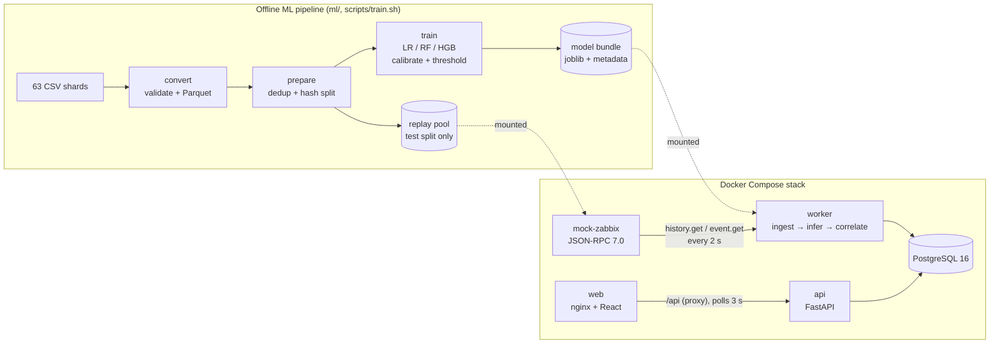
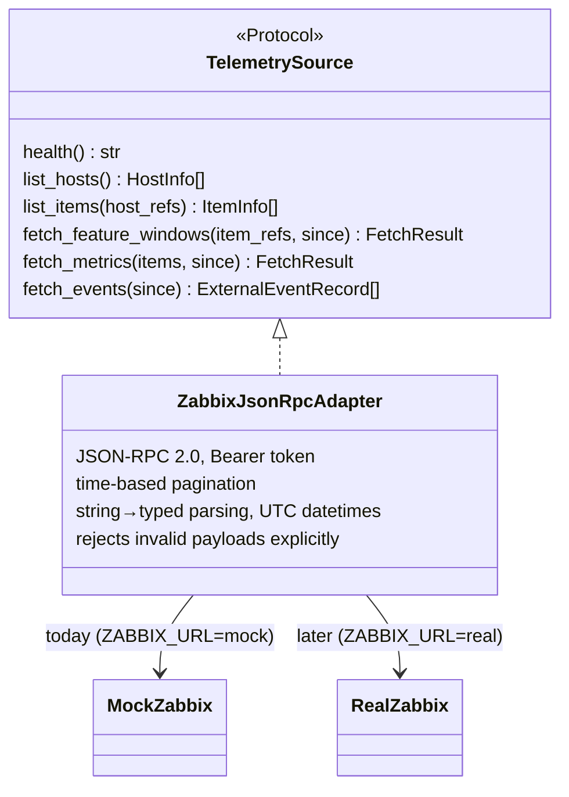

# Architecture

## 1. System overview



| Component | Responsibility | Does NOT do |
|---|---|---|
| **mock-zabbix** | Serves `apiinfo.version`, `host.get`, `item.get`, `history.get`, `trend.get`, `event.get` and `problem.get` with the structures documented in `ZABBIX_doc/`. Telemetry is a pure function of (seed, host, time) | Detection of any kind |
| **worker** | Polls the source, normalises and persists telemetry, scores new windows, groups anomalies into incidents, applies retention, records source health and pipeline runs | Serve HTTP |
| **api** | Read APIs for the dashboard; incident acknowledge/resolve; runs migrations on start | Ingestion or inference (it never depends on the worker being called) |
| **web** | Dashboard (React SPA served by nginx, `/api` reverse-proxied) | Business logic: every rule lives in the backend |
| **db** | System of record | n/a |

Ingestion and inference run in the worker, independent of the API and of any frontend request.

## 2. Source-adapter abstraction



- `backend/app/sources/base.py` defines the normalised types (`HostInfo`, `FeatureWindowRecord`, …). Nothing
  downstream sees a Zabbix structure: no string-typed values, no `clock`/`ns`, no JSON-RPC envelopes.
- The mock is a **fake Zabbix server**, not a fake adapter. The production adapter is therefore exercised in
  every test and every demo. Moving to a real Zabbix is a configuration change, see [real_zabbix.md](real_zabbix.md).
- Model features travel as one custom Zabbix item per host, `netad.flow.features` (value_type 4 = text). Its value
  is a JSON object of the 39 CICIoT-style window features. Numeric items (interface traffic, CPU, firewall
  states) are ingested for context and are **not** used by the model.

## 3. Online pipeline (one worker cycle, every `POLL_INTERVAL_SECONDS` = 2 s)

```mermaid
sequenceDiagram
  participant W as worker
  participant Z as Zabbix (mock)
  participant DB as PostgreSQL
  W->>Z: host.get / item.get (every 60 s)
  W->>DB: upsert hosts, items (missing hosts → inactive)
  loop per feature item
    W->>Z: history.get(history=4, time_from=watermark, ASC, limit)
    Z-->>W: windows (paged by time)
    W->>DB: INSERT feature_windows ON CONFLICT DO NOTHING; move watermark
  end
  W->>Z: history.get(numeric items) + event.get(lookback 1 h)
  W->>DB: metric_samples, external_events (upsert recoveries)
  W->>DB: SELECT windows without prediction
  W->>W: ModelBundle.predict (validated, ordered features)
  W->>DB: INSERT predictions (p_attack, category, is_anomaly)
  W->>DB: correlate: debounce, group, auto-resolve, link Zabbix problems
  W->>DB: INSERT pipeline_runs (counts, error)
```

Properties:
- **Idempotent.** Unique `(item_id, ts, ns)` constraints and watermarks mean a crashed or repeated cycle never
  duplicates data.
- **Failure handling.** Transport errors (`SourceUnavailable`) and protocol errors (`SourceProtocolError`)
  update `source_health` (`up` → `degraded` → `down` after 3 consecutive failures) and trigger exponential
  backoff (capped at 30 s). Inference and correlation keep draining stored data. After recovery the watermark
  backfills the gap.
- **Nothing is dropped silently.** Unparseable payloads are counted (`pipeline_runs.windows_rejected`) and
  logged. Windows the model rejects keep an `invalid_reason`.
- **Latency.** Measured end to end (window produced → visible in the API) at about 2–6 s in the local integration
  run.

## 4. Offline pipeline

```mermaid
flowchart TD
  A[63 CSV, 45.0M rows] -->|convert: header check, reject NaN/inf/truncated| B[Parquet float32, 45.02M rows]
  B -->|prepare: hash(features) → split bucket; exact dedup| C[20.7M unique rows]
  C --> T[train 70%] & V[validation 15%] & X[test 15%]
  T -->|cap 100k/attack label, all benign| F[fit LR, RF, HGB + ablations]
  V -->|half A| CAL[isotonic calibration]
  V -->|half B| THR[threshold: benign FPR ≤ 1%; model selection]
  X --> EV[final evaluation, untouched until here]
  X --> RP[replay pool for the demo]
  F --> CAL --> THR --> EV --> BUN[versioned bundle + metadata.json + sha256]
```

Details are in [ml_methodology.md](ml_methodology.md).

## 5. Data model

```mermaid
erDiagram
  hosts ||--o{ items : has
  hosts ||--o{ feature_windows : produces
  items ||--o{ feature_windows : "source item"
  items ||--o{ metric_samples : "numeric values"
  items ||--o| ingest_watermarks : "last ingested ts"
  feature_windows ||--o| predictions : "scored as"
  model_versions ||--o{ predictions : "made by"
  incidents ||--o{ predictions : "groups anomalies"
  hosts ||--o{ incidents : on
  hosts ||--o{ external_events : "Zabbix problems"
  incidents ||--o{ incident_external_links : ""
  external_events ||--o{ incident_external_links : ""
  hosts { int id PK; string source_ref UK; string name; string criticality; jsonb tags; bool active }
  items { int id PK; int host_id FK; string source_ref UK; string key; enum kind; int value_type }
  feature_windows { bigint id PK; int host_id FK; int item_id FK; timestamptz ts; bigint ns; jsonb features; text invalid_reason }
  predictions { bigint window_id PK_FK; int host_id; timestamptz ts; float p_attack; string category; jsonb category_proba; bool is_anomaly; bool correlated; int incident_id FK }
  incidents { int id PK; int host_id FK; enum status; enum severity; string category; jsonb category_counts; timestamptz opened_at; timestamptz last_seen_at; timestamptz resolved_at; int anomaly_count; float max_score }
  external_events { int id PK; string source_ref UK; int host_id FK; string name; int severity; timestamptz clock; timestamptz recovered_at }
  model_versions { int id PK; string version UK; string algorithm; string sha256; float threshold; jsonb metadata; bool is_active }
```

Additional tables: `metric_samples (item_id, ts) PK`, `source_health`, `pipeline_runs`, `ingest_watermarks`.

**Vocabulary.** *Telemetry* is `feature_windows` and `metric_samples`. A *prediction* is the model output for
every window. An *anomaly* is a prediction with `is_anomaly` (score ≥ threshold). An *incident* is a group of
anomalies with a lifecycle. A *Zabbix problem* is an `external_events` row, only ever **linked** to incidents and
never merged with them.

`predictions.host_id/ts` duplicate two immutable values from `feature_windows`. This deliberate denormalisation
lets score timelines use the `(host_id, ts)` index without a join.

**Indexes and retention.** There are `(host_id, ts)` indexes on windows and predictions, plus partial indexes
`WHERE is_anomaly` and `WHERE NOT correlated`. Retention (`RETENTION_DAYS`, default 7) deletes raw telemetry but
keeps windows referenced by incidents.

**Is PostgreSQL enough?** Yes. The demo load is 3 hosts × 0.5 windows/s, about 130k windows/day, plus about 75k
metric samples/day. Pagination, bucketing (`date_bin`) and retention keep queries bounded. TimescaleDB, Kafka,
Redis or Celery would add operational cost without solving a problem this system has.

## 6. Incident lifecycle

```mermaid
stateDiagram-v2
  [*] --> open: ≥3 of last 5 windows anomalous (debounce)
  open --> acknowledged: analyst (note, local only)
  open --> resolved: analyst, or auto after 120 s without anomalies
  acknowledged --> resolved: analyst, or auto
  resolved --> [*]
  note right of open: anomalies ≤60 s apart join the active incident of the host;<br/>a later recurrence opens a NEW incident
```



- **Grouping key = host.** Grouping by (host, category) was approved in the design, but measurements showed the
  model alternates DoS/DDoS window by window (DoS recall 0.47). Category-keyed grouping would split one attack
  into many incidents. The incident therefore stores a dominant category plus the full distribution
  (`category_counts`).
- **Time base.** Auto-resolution uses telemetry time (the newest scored window of the host), not wall-clock time.
  A source outage therefore never "resolves" an ongoing attack.
- **Severity.** Derived from the maximum score, the number of anomalies and the host's `criticality` tag.
- **Linking.** Zabbix problems on the same host whose lifetime overlaps `[opened − 60 s, last_seen + 60 s]` are linked.

## 7. Deployment

| Service | Image | Port (127.0.0.1) | Notes |
|---|---|---|---|
| db | postgres:16.6-alpine | 5432 | volume `pgdata`, healthcheck `pg_isready` |
| mock-zabbix | built from `mock_zabbix/` | 8081 | mounts `artifacts/replay` read-only |
| api | `netad-backend:local` (target `runtime`) | 8000 | `RUN_MIGRATIONS=1` → `alembic upgrade head` with retries |
| worker | same image | — | starts after the api is healthy (migrations applied) |
| web | built from `frontend/` (node build → nginx) | 8080 | SPA fallback, `/api` proxy |
| trainer / backend-tests | profiles `train` / `test` | — | on-demand only |

Every configurable value is an environment variable (`.env.example`).
