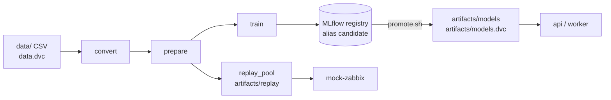

# MLOps workflow: DVC + MLflow + MinIO

Git holds code and small pointer files. Large binaries (the 8.7 GB dataset, model bundles, the replay pool)
live in an S3 object store, and every step runs in Docker.

| Tool | Role | Where |
|---|---|---|
| **DVC** | Versions `data/`, `artifacts/models/` and `artifacts/replay/`. Defines the reproducible pipeline (`dvc.yaml`, `params.yaml`, `dvc.lock`) | `trainer` container |
| **MLflow** | Experiment tracking (params, metrics, plots, the bundle for every run) and the **model registry** (`candidate` / `production` aliases) | `mlflow` service, UI at http://localhost:5050 |
| **MinIO** | S3-compatible store: bucket `netad-dvc` (DVC remote) and `mlflow` (MLflow artifacts). Change env vars to move to AWS S3 | `minio` service, console at http://localhost:9001 |
| PostgreSQL | MLflow run and registry metadata | `mlflow-db` service |



## Daily workflow

```bash
./scripts/mlops.sh up            # MinIO + MLflow (other scripts start them automatically)
# edit params.yaml or ml/netad_ml/*.py
./scripts/train.sh               # dvc repro: re-runs only the stages that changed, logs the run to MLflow,
                                 # registers the new version as "candidate", then dvc push
# compare runs in the MLflow UI, or: ./scripts/dvc.sh metrics diff HEAD
./scripts/promote.sh             # registry "candidate" -> artifacts/models (sha256 verified) -> alias "production"
git add dvc.lock artifacts/models.dvc params.yaml && git commit -m "model: promote <version>"
./scripts/restart.sh api worker
```

- Roll back: `./scripts/promote.sh <registry version>` (see `./scripts/mlops.sh models`).
- Fresh clone or another machine: `./scripts/start.sh` runs `dvc pull` for the model and replay pool when they
  are missing. `./scripts/dvc.sh pull` fetches everything, including `data/`.
- Any DVC command: `./scripts/dvc.sh status | dag | params diff | metrics show`.

## Design decisions

- **The bundle format stays the model format.** MLflow stores the existing `model.joblib` + `metadata.json`
  (sha256) as the run artifact `bundle/` and registers that path. It does not use an MLflow sklearn flavour.
  The backend still loads only through `netad_ml.runtime.ModelBundle` and **does not depend on MLflow at
  runtime**. If the MLflow server is down, serving is unaffected.
- **Promotion is explicit.** Training never changes what is served. `promote.sh` verifies the sha256, replaces
  the single bundle in `artifacts/models/` (the backend serves the newest bundle it finds there) and commits it
  to DVC, so each git commit pins the exact model the stack serves.
- **Intermediate outputs are not cached** (`ml/work/*`, `cache: false`). They are derived from versioned data
  and code, and caching them would double the disk use.
- The train stage always runs with `--fresh`, so a parameter change can never reuse stale checkpoints.
- Traceability: each MLflow run is tagged with `git_commit`, `data_md5` (from `data.dvc`), `bundle_version`
  and `sha256`.
- Artifacts are proxied through MLflow (`--serve-artifacts`), so only the MLflow server holds S3 credentials
  for its bucket.
- The `trainer` container runs as the host user, so files it writes into the repo are not owned by root.

## One-time migration (repositories that predate DVC)

```bash
./scripts/mlops.sh bootstrap
```
1. `dvc add data` copies the files into `.dvc/cache` (cache type `copy`, so `data/` is never modified).
2. `dvc commit` records the existing `ml/work` and replay outputs in `dvc.lock` without recomputing them.
3. It registers the existing bundle in MLflow as `production`.
4. It runs `dvc add artifacts/models`, then `dvc push`.

Then commit `data.dvc dvc.lock artifacts/models.dvc`.
The first `train.sh` after this runs the `train` stage, because it has never run under DVC.

Disk: `.dvc/cache` (~10 GB) plus the `minio-data` volume (~10 GB). `reset.sh` deletes only the application
database. `minio-data` and `mlflow-pg` hold the versioned history, so only remove them on purpose.

Note: the 83 MB bundle committed before the migration stays in git history (this was a deliberate choice).
New model versions no longer go into git.
